 

---

## 🗡️ &nbsp;Codename

<table>
<tr>
<td valign="top" width="50%">

<pre>
name    : Danu
alias   : danu155
order   : SMK Negeri 7 Semarang (SIJA)
role    : Network &amp; Cyber Security Enthusiast
mission : Become a Penetration Tester
creed   : Learn. Hack. Defend.
status  : We work in the dark to serve the light
</pre>

</td>
<td valign="top" width="50%">

> *"When other men blindly follow the truth, remember… **Nothing is true.**"*
> *"When other men are limited by morality or law, remember… **Everything is permitted.**"*

**Fokus sekarang:**
- 🎯 Recon & Web App Pentesting
- 🕸️ Network Security & Hardening
- 🧪 CTF — Web / Crypto / Forensics
- 🐧 Linux, scripting & automation

</td>
</tr>
</table>

---

## ⚔️ &nbsp;Arsenal

**Languages & Web**

**Systems & Security Tools**

  

---

## 📊 &nbsp;Brotherhood Stats

 

---

## 🗺️ &nbsp;Territory

---

## 🐍 &nbsp;Contribution Snake

<picture>
  <source media="(prefers-color-scheme: dark)" srcset="https://raw.githubusercontent.com/danu155/danu155/output/github-contribution-grid-snake-dark.svg"/>
  <source media="(prefers-color-scheme: light)" srcset="https://raw.githubusercontent.com/danu155/danu155/output/github-contribution-grid-snake.svg"/>
  
</picture>

---

## 🌐 &nbsp;Find Me

  

  

